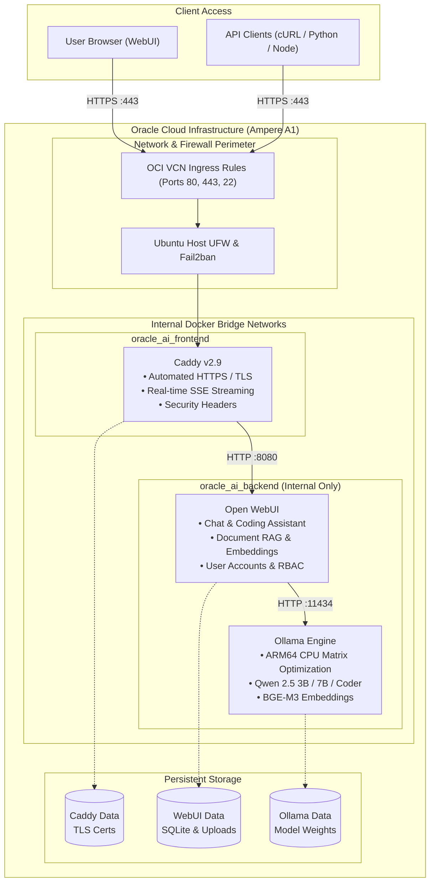

# Oracle Cloud Personal AI Server

> A production-minded, automated, self-hosted AI platform optimized for Oracle Cloud Always Free Ampere A1 ARM64 instances. Powered by **Ollama**, **Open WebUI**, and **Caddy**.

[](LICENSE)
[]()
[]()
[-green.svg)]()
[-1f883d.svg)]()
[]()

---

## Overview

This repository provides an automated, production-hardened blueprint to turn Oracle Cloud Infrastructure's (OCI) **Always Free** tier into your private, self-hosted AI server with **zero recurring costs**.

### Key Highlights
- **100% Free Tier Eligible:** Engineered specifically for the Ampere A1 Compute shape (4 OCPU ARM64, 24 GB RAM, 50–200 GB NVMe storage).
- **Private & Self-Contained:** Ollama runs isolated on internal Docker networks with zero external port exposure.
- **Automated SSL/TLS:** Caddy reverse proxy automatically provisions and renews Let's Encrypt certificates with HTTP/2 and HTTP/3 (QUIC) support.
- **RAG & Document Intelligence:** Pre-configured with the state-of-the-art multilingual embedding model (`bge-m3`) for instant document chat and semantic search.
- **Hardened Host & Containers:** Fail2ban SSH jail, UFW firewall rules, non-root execution policies, and automated secret generation.
- **Modular Ecosystem:** Plug-and-play modules for Qdrant (Vector DB), SearXNG (Private Web Grounding), n8n (Automation), LiteLLM (OpenAI-compatible Gateway), Netdata, and Uptime Kuma.
- **Day-2 Operations:** Production scripts for 1-command automated backups (with SHA256 checksums), rolling upgrades, hardware preflight checks, and sanitized diagnostic bundles.

---

## Architecture



---

## Hardware & Environment Specifications

| Component | Specification |
|---|---|
| **Target Cloud** | Oracle Cloud Infrastructure (OCI) Always Free Tier |
| **Compute Shape** | `VM.Standard.A1.Flex` |
| **Processor Architecture** | ARM64 / `aarch64` (Ampere Altra Neoverse-N1) |
| **CPUs** | 4 OCPU (4 physical ARM cores) |
| **Memory** | 24 GB RAM |
| **Operating System** | Ubuntu 24.04 LTS (`noble`) ARM64 |
| **Inference Hardware** | CPU-only (Tuned OpenMP threading & matrix multiplication) |
| **Reverse Proxy** | Caddy v2.9 with Automatic HTTPS |

---

## Quick Start Deployment

### Method A: Direct on VPS (Fastest)

SSH into your Oracle Cloud Ubuntu VPS and run:

```bash
# 1. Clone the repository
git clone https://github.com/kiranveer111/free-tier-personal-ai.git oracle-ai-server
cd oracle-ai-server

# 2. Make automation scripts executable
chmod +x scripts/*.sh

# 3. Create your environment configuration
cp .env.example .env
nano .env   # Set your domain (or <YOUR_VPS_IP>.nip.io) and admin email

# 4. Run the 12-step master installer
./scripts/install.sh
```

---

### Method B: Deploy from Your Local Machine

If you prefer preparing locally and pushing to your VPS:

```bash
# 1. Configure VPS variables
VPS_HOST="ubuntu@<YOUR_VPS_IP>"
SSH_KEY="~/.ssh/oracle_vps.key"

# 2. Copy the stack to your remote instance
rsync -avz --exclude '.git' --exclude '.env' -e "ssh -i $SSH_KEY" ./ $VPS_HOST:/home/ubuntu/oracle-ai-server/

# 3. SSH into the instance and run installation
ssh -i $SSH_KEY $VPS_HOST "cd /home/ubuntu/oracle-ai-server && chmod +x scripts/*.sh && cp .env.example .env && nano .env && ./scripts/install.sh"
```

---

## Detailed Step-by-Step Setup

### 1. Oracle Cloud Network Security (VCN)
Before installation, configure your OCI Virtual Cloud Network (VCN) Ingress Rules:

| Protocol | Source | Destination Port | Purpose |
|---|---|---|---|
| **TCP** | `0.0.0.0/0` | `80` | HTTP ACME challenge & HTTP to HTTPS redirection |
| **TCP** | `0.0.0.0/0` | `443` | Secure HTTPS WebUI & API |
| **UDP** | `0.0.0.0/0` | `443` | HTTP/3 QUIC acceleration (Optional) |
| **TCP** | `YOUR_IP/32` | `22` | SSH Administration |

> [!CAUTION]
> Never open internal service ports (`11434`, `8080`, `6333`, `5678`) in the OCI Security List. All internal traffic is securely proxied through Caddy.

### 2. DNS Setup
Point an **A Record** from your domain registrar to your VPS public IPv4:
```text
ai.yourdomain.com    IN    A    <YOUR_VPS_IP>
```
*(Testing alternative: If you don't own a domain yet, set `AI_DOMAIN=<YOUR_VPS_IP>.nip.io` in `.env` for automatic wildcard DNS).*

### 3. First Admin Account
1. Open your browser and navigate to `https://ai.yourdomain.com` (or your `.nip.io` address).
2. Click **Sign Up** and create the first account. The first registered account automatically receives full Administrator privileges.
3. Once registered, edit `.env` and set `ENABLE_SIGNUP=false`, then run `./scripts/deploy.sh` to lock down public registration.

---

## Model Management & Benchmarks

The stack includes a model management utility optimized for ARM64 CPU inference:

```bash
# Install Recommended Starter Pack (Qwen 2.5 3B + BGE-M3 Embeddings):
./scripts/install-models.sh --recommended

# Install Coding Pack (Qwen 2.5 Coder 7B + BGE-M3):
./scripts/install-models.sh --coder

# Interactive Model Selection Menu:
./scripts/install-models.sh

# Run CPU Benchmark on an installed model:
./scripts/install-models.sh --benchmark qwen2.5:3b
```

### Verified Ampere A1 (4 OCPU) Performance Benchmarks:

| Model | Parameters | Quantization | RAM Usage | Speed (Tokens/s) | Best Use Case |
|---|---|---|---|---|---|
| **`qwen2.5:3b`** | 3.1B | Q4_K_M | ~2.2 GB | **~12.86 t/s** | Fast general chat, reasoning, mobile |
| **`qwen2.5-coder:7b`** | 7.6B | Q4_K_M | ~5.0 GB | **~4.50 t/s** | Code generation, debugging, refactoring |
| **`bge-m3`** | 567M | FP16 | ~1.4 GB | Sub-second | Multilingual semantic search & RAG embeddings |

---

## Optional Plug-and-Play Modules

Extend your stack with pre-configured modular extensions:

```bash
# Enable Qdrant vector database:
docker compose -f compose.yaml -f modules/qdrant/compose.yaml up -d

# Enable SearXNG private search grounding:
docker compose -f compose.yaml -f modules/searxng/compose.yaml up -d

# Enable n8n workflow automation:
docker compose -f compose.yaml -f modules/n8n/compose.yaml up -d

# Enable LiteLLM OpenAI-compatible gateway:
docker compose -f compose.yaml -f modules/litellm/compose.yaml up -d

# Enable Netdata real-time monitoring:
docker compose -f compose.yaml -f modules/netdata/compose.yaml up -d
```

---

## Day-2 Operations & Management

| Task | Command | Description |
|---|---|---|
| **Health Check** | `./scripts/health-check.sh` | Full verification of containers, TLS, ports, and inference |
| **Diagnostics** | `./scripts/diagnostics.sh` | Generates a sanitized diagnostic dump without secrets |
| **Update Stack** | `./scripts/update.sh` | Pulls latest ARM64 images with automatic pre-update backup |
| **Backup** | `./scripts/backup.sh` | Backs up WebUI DB and TLS certs with SHA256 verification |
| **Restore** | `./scripts/restore.sh <file>` | Restores data volume from a compressed archive |
| **Clean Teardown** | `./scripts/remove.sh` | Safely stops containers and preserves persistent volumes |

---

## Directory Layout

```text
oracle-ai-server/
├── README.md               # Project documentation & quickstart
├── LICENSE                 # MIT License
├── .gitignore              # Git ignore rules for secrets and backups
├── .env.example            # Environment configuration template
├── compose.yaml            # Core Docker Compose specification
├── Caddyfile               # Caddy reverse proxy & TLS configuration
│
├── config/                 # Service configurations
│   ├── ollama/             # Ollama CPU inference settings
│   ├── open-webui/         # WebUI presets & embedding config
│   ├── caddy/              # Caddy security headers
│   └── monitoring/         # Monitoring thresholds
│
├── scripts/                # Safe automation scripts (set -euo pipefail)
│   ├── install.sh          # 12-step master installer
│   ├── preflight-check.sh  # Hardware, OS, and network verification
│   ├── setup-firewall.sh   # UFW & Fail2ban host configuration
│   ├── setup-docker.sh     # Docker CE & Compose ARM64 installer
│   ├── deploy.sh           # Core service deployment & verification
│   ├── update.sh           # Safe image updates with rollback backup
│   ├── backup.sh           # Automated volume backup & sha256 checksum
│   ├── restore.sh          # Safe system restoration
│   ├── health-check.sh     # Full stack health & metrics checker
│   ├── install-models.sh   # Model installer & CPU benchmarking
│   ├── remove.sh           # Teardown & cleanup
│   └── diagnostics.sh      # Sanitized diagnostic bundle generator
│
├── modules/                # Optional plug-and-play modular services
│   ├── qdrant/             # Vector database for high-scale RAG
│   ├── searxng/            # Private search engine for web grounding
│   ├── n8n/                # Workflow automation engine
│   ├── litellm/            # OpenAI-compatible API gateway
│   ├── uptime-kuma/        # Uptime & service monitor
│   ├── netdata/            # Real-time host performance dashboard
│   └── code-server/        # In-browser VS Code IDE
│
├── docs/                   # Detailed technical documentation
│   ├── INSTALLATION.md     # In-depth setup guide
│   ├── ARCHITECTURE.md     # Architecture & technical specs
│   ├── SECURITY.md         # Hardening & security matrix
│   ├── MODELS.md           # Model catalog & performance benchmarks
│   ├── BACKUP-RESTORE.md   # Backup & disaster recovery runbook
│   ├── TROUBLESHOOTING.md  # Issue diagnosis & resolution
│   ├── API-USAGE.md        # Python, Node.js, and curl integration
│   ├── MAINTENANCE.md      # Maintenance runbook
│   └── DEPLOYMENT_LOG.md   # Step-by-step audit log of all deployment actions
│
└── backups/                # Protected backup archive destination
    └── .gitkeep
```

---

## Documentation Index

- [Installation Guide](docs/INSTALLATION.md)
- [Architecture & Technical Specifications](docs/ARCHITECTURE.md)
- [Security Hardening Guide](docs/SECURITY.md)
- [Models & Benchmarking](docs/MODELS.md)
- [Backup & Restore Procedures](docs/BACKUP-RESTORE.md)
- [Troubleshooting & Diagnostics](docs/TROUBLESHOOTING.md)
- [API Integration Examples](docs/API-USAGE.md)
- [Maintenance Runbook](docs/MAINTENANCE.md)
- [Deployment Step-by-Step Action Log](docs/DEPLOYMENT_LOG.md)

---

## License

This project is licensed under the MIT License - see the [LICENSE](LICENSE) file for details.
