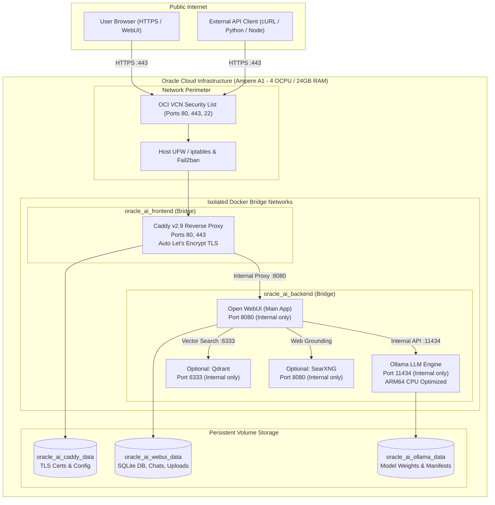

# System Architecture & Technical Specifications

This document outlines the architecture, networking topology, storage layout, and CPU inference optimizations of the **Oracle Cloud Personal AI Server**.

---

## 1. High-Level Architecture Diagram

---

## 2. Network Topology & Isolation Principles

1. **Zero Exposure of Internal APIs:**
   - **Ollama (`11434`)** is never bound to host `0.0.0.0`. It only exists within the private Docker bridge network `oracle_ai_backend`.
   - **Open WebUI (`8080`)** is isolated from host ports. Traffic only enters Open WebUI via Caddy on the `oracle_ai_frontend` network.
   - **Caddy (`80` and `443`)** is the only container with host port bindings.

2. **Dual-Tier Network Segmentation:**
   - `oracle_ai_frontend`: Contains Caddy and Open WebUI. Ollama is isolated from this network.
   - `oracle_ai_backend`: Contains Open WebUI and Ollama (plus optional internal modules like Qdrant and SearXNG).

3. **HTTP/2, HTTP/3, and Real-Time SSE Streaming:**
   - Caddy handles TLS termination with modern cipher suites and HTTP/3 (QUIC) support over UDP 443.
   - Real-time Server-Sent Events (SSE) token streaming is unbuffered (`flush_interval -1`), allowing instant token-by-token generation in Open WebUI.

---

## 3. Storage Layout & Persistence

All stateful application components utilize named Docker volumes to guarantee zero data loss during container upgrades:

| Volume Name | Mounted Path | Purpose | Backup Priority |
|---|---|---|---|
| `oracle_ai_caddy_data` | `/data` in Caddy | Active TLS certs and ACME keys | High |
| `oracle_ai_caddy_config` | `/config` in Caddy | Autosaved Caddy runtime configuration | Low |
| `oracle_ai_webui_data` | `/app/backend/data` in WebUI | SQLite database, user accounts, chat logs, uploaded RAG docs | **Critical** |
| `oracle_ai_ollama_data` | `/root/.ollama` in Ollama | Quantized model weights (`GGUF`), manifests | Medium (re-downloadable) |

---

## 4. CPU-Only Inference Optimization (Ampere A1 ARM64)

The Oracle Cloud Always Free shape provides **4 OCPUs (4 physical Neoverse-N1 cores)** and **24 GB RAM**. Because there is no GPU, inference is optimized for CPU execution:

1. **OMP Threading (`OMP_NUM_THREADS=4`):**
   - Directs OpenMP matrix algebra operations to utilize all 4 physical ARM cores without hyperthreading context overhead.
2. **Serial Execution (`OLLAMA_NUM_PARALLEL=1`):**
   - Restricts concurrent inferences to 1 request. Concurrently running multiple inferences on a 4-core CPU degrades performance significantly due to thread thrashing.
3. **Single Active Model (`OLLAMA_MAX_LOADED_MODELS=1`):**
   - Keeps only one LLM active in RAM at a time. Switching models safely evicts the inactive model to prevent high memory pressure.
4. **Persistent Keep-Alive (`OLLAMA_KEEP_ALIVE=24h`):**
   - Avoids the 5-10 second cold-start model load delay on subsequent chats by keeping weights pinned in memory.
5. **Generous Context Window (`OLLAMA_CONTEXT_SIZE=8192`):**
   - Configured for up to 8,192 tokens to support long coding sessions and document RAG processing.

---

## 5. Container Resource Guardrails

| Container | CPU Limit | Memory Limit | Memory Reservation |
|---|---|---|---|
| `ollama` | 3.5 cores | 16 GB | 4 GB |
| `open-webui` | 1.5 cores | 4 GB | 1 GB |
| `caddy` | 0.5 cores | 1 GB | 128 MB |
| **System Overhead Reserve** | 0.5 cores | 3 GB | N/A (Reserved for Linux OS & cache) |

